<div align="center">
  <a href="https://pixlstash.dev"></a>
  <h1>ComfyUI-PixlStash</h1>
  <p>Custom ComfyUI nodes for loading and saving images to a PixlStash vault.</p>
  <p>
    <a href="https://pixlstash.dev"><strong>pixlstash.dev</strong></a>
    &nbsp;&nbsp;|&nbsp;&nbsp;
    <a href="https://github.com/Pikselkroken/pixlstash"><strong>github.com/Pikselkroken/pixlstash</strong></a>
  </p>
</div>

---

<div align="center">
  <a href="examples/PixlStash-SearchImageEdit.json">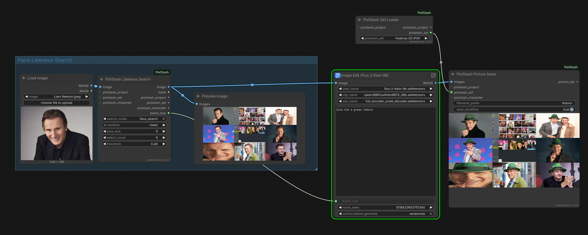</a>
  <p><sub>Semantic search to image edit, end to end. <a href="examples/PixlStash-SearchImageEdit.json">Open this workflow</a>.</sub></p>
</div>

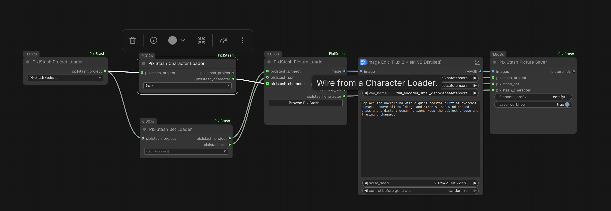

[Download example workflow](PixlStash-LoadAndSave.json)

## Overview

These nodes connect ComfyUI to a PixlStash vault. Load images by project, set or
character, run them through any pipeline, and save the results back with
metadata. Models can be loaded from the PixlStash model shelf too.

Set the URL and API token once in **ComfyUI Settings > PixlStash**. The nodes
read them at runtime, so they never end up in saved workflow JSON.

## Nodes

| Node | What it does | Added in | Needs PixlStash |
|---|---|---|---|
| Project Loader | Picks a project. Outputs a wire to scope other nodes. | 1.0 | 1.0 |
| Set Loader | Picks a set inside a project. | 1.0 | 1.0 |
| Character Loader | Picks a character. | 1.0 | 1.2.1 |
| Picture Loader | Loads images as `IMAGE` and `MASK`. Pick them in a thumbnail browser, or leave the selection empty to fetch everything matching the wired filters. | 1.0 | 1.0 |
| Picture Saver | Uploads images, optionally filed under a project, set or character. Can embed the workflow in PNGs. | 1.0 | 1.0 |
| Video Saver | ComfyUI's Save Video, saving to PixlStash: the same format, codec and encoding options, with the video optionally filed under a project, set or character. Can embed the workflow in the file. | 1.7 | 1.2 |
| Likeness Search | Finds pictures by facial or image similarity to reference images. | 1.1 | 1.4 |
| Semantic Search | Finds pictures by text. | 1.1 | 1.4 |
| Face Likeness Gate | Splits a batch into `accepted` and `rejected` by how well each face matches a character. | 1.2 | 1.6 |
| Picture Likeness Gate | Same, judged on whole-image likeness to a reference picture set. | 1.3.1 | 1.4 |
| Adapter (LoRA) Loader | Applies a LoRA from the model shelf. | 1.5 | 1.10 |
| Multi Adapter (LoRA) Loader | Applies several LoRAs from the model shelf, one row each, in one node. Can list people instead of files. | 1.7 | 1.12 |
| Checkpoint Loader | Loads a checkpoint from the model shelf. | 1.5 | 1.10 |
| VAE Loader | Loads a VAE from the model shelf. | 1.5 | 1.10 |
| CLIP Loader | Loads one or two text encoders from the model shelf. | 1.5 | 1.10 |
| ControlNet Loader | Loads a ControlNet from the model shelf. | 1.7 | 1.12 |
| Workflow Set Loader | Loads a workflow set's checkpoint, text encoders and VAE in one node, and narrows an Adapter Loader to the set's LoRAs. | 1.6 | 1.12 |

"Added in" is the ComfyUI-PixlStash version. The Face Likeness Gate also needs a
running face-extraction worker. A node checks the server's version before its
first request and refuses an older PixlStash with a message naming both
versions, rather than failing on a route the server does not have yet.

The search and gate nodes take optional project, set and character inputs as
filters. The loaders pass their context through, so a saver downstream needs no
extra wiring.

### Search

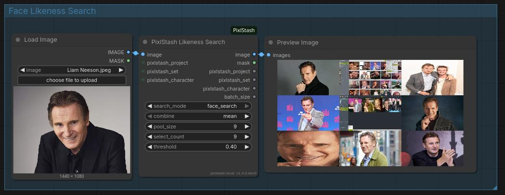

Image search takes several images at once, so you can combine concepts. "An old
man and a young man drinking beer" returns four older men drinking beer:

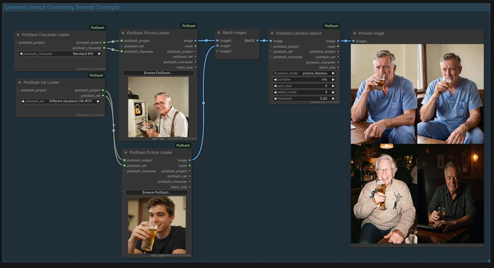

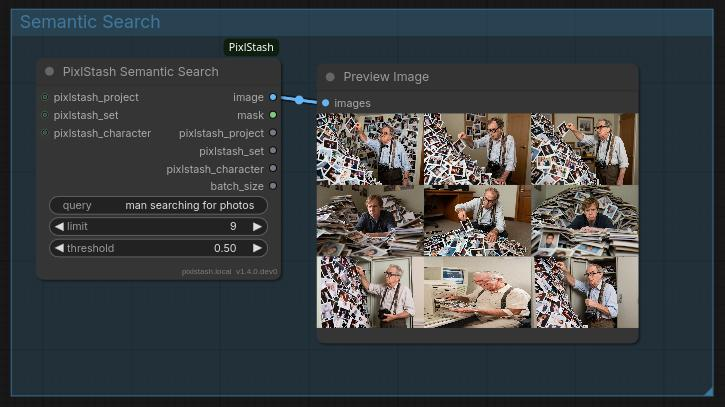

### Gates

Wire in a batch of generations plus a Character Loader (face) or Set Loader
(picture), set a `threshold`, and route `accepted` to an upscale or save branch
so you never waste compute on a bad match. Both also output
`accepted_count` / `rejected_count` and pass the reference through.

The Picture Likeness Gate's `combine` mode decides how per-member scores become
one verdict: `min` (default) means match every member of the set, `max` means
match any.

Both score server-side and write nothing to the vault. A read-scope token is
enough.

### Model shelf loaders

Pick models from a thumbnail grid instead of a dropdown of hundreds of
filenames. Each loader has the same inputs and outputs as its ComfyUI built-in,
so it drops straight into an existing graph. The Adapter Loader adds a
`trigger_words` output.

Once picked, the node shows the model's name and its face: a resizable
thumbnail on the Adapter (LoRA) Loader, where seeing the face is the point,
a row per adapter on the Multi Adapter (LoRA) Loader, and a small favicon on
the others — so a graph with four loaders stays readable without any of them
ballooning in size.

[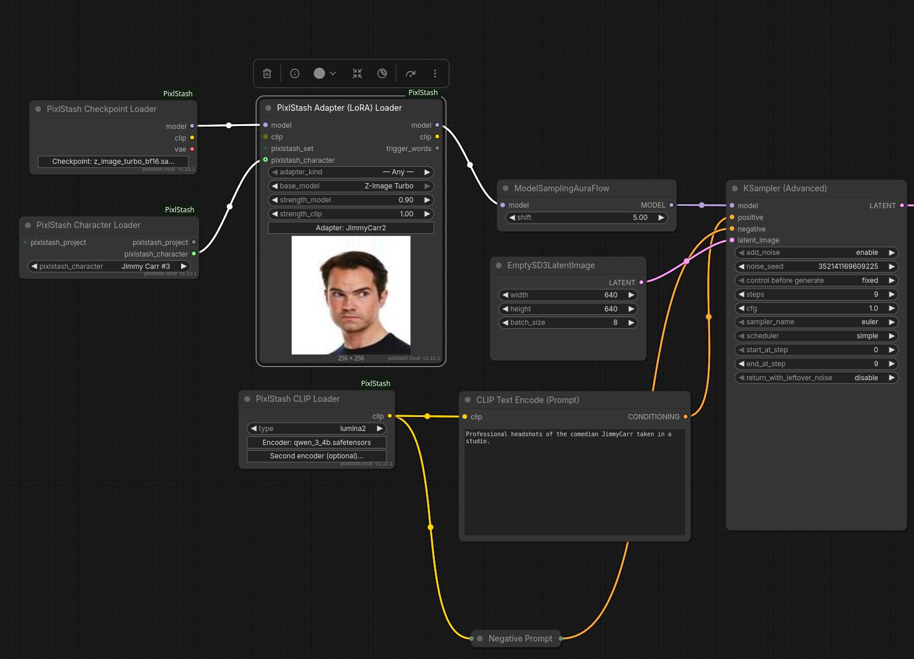](examples/PixlStash-FaceLikenessGateUpscaleModels.json)

Wire a Set or Character Loader into the Adapter Loader to see only that
character's or set's adapters.

The Multi Adapter (LoRA) Loader is the same loader for several adapters at
once, with the same model, clip and `trigger_words` wires; it does not take a
Set, Character or Workflow Set Loader. Each picked adapter is a row with its
picture, the person it is attached to, its trigger word (click it to copy) and
its own two strengths. The rows are applied top to bottom, exactly as that many chained
Adapter Loaders would be, and `trigger_words` carries every row's words in row
order. Browse opens the same grid with several cards tickable; the number
on a card is the row it will fill. Set `show` to *People who fit* and the grid
lists people instead of files: everyone with an adapter for the chosen
`base_model`, with a choice between their adapters when more than one fits. A
node with no rows passes the model and clip through untouched. It holds up to
eight rows, stored in the workflow as `adapter_sha256`, `strength_model`,
`strength_clip`, then `adapter_sha256_2` and so on.

The Workflow Set Loader loads one of the workflow sets you made on the shelf:
its checkpoint, with the set's text encoders and VAE in place of the
checkpoint's own. It does not apply the set's LoRAs, since a set records no
order or strengths. Wire its `pixlstash_workflow_set` output into an Adapter
Loader instead, and that loader's Browse grid shows only the set's LoRAs.

The CLIP, Checkpoint and Workflow Set loaders also read `.gguf` files, through
a bundled copy of [ComfyUI-GGUF](https://github.com/city96/ComfyUI-GGUF), so
you do not need that pack installed. A GGUF text encoder can be paired with a
safetensors one. A GGUF checkpoint is a diffusion model only: its CLIP and VAE
outputs are empty, so wire those from their own loaders. The VAE, ControlNet
and Adapter loaders take `.safetensors` only.

Files are used in place when ComfyUI and PixlStash share a filesystem. Adapters,
VAEs, text encoders and ControlNets are otherwise fetched once and cached under
`pixlstash/<sha256>.safetensors` (or `.gguf`) in the matching models directory, verified
against the digest. **Checkpoints cannot be fetched** and must be readable
locally.

**Note:** the shelf needs an owner token. Resource-scoped share tokens get a 403.

## What a run reports

A workflow says what to *look for*; a run resolves that to what was actually
*used*. A Picture Loader with an empty selection picks its batch off a live
query, a search node picks its off a score, and a shelf hash becomes one
particular file. None of that is in the saved workflow, and re-running it
tomorrow can legitimately resolve to something else.

So the Picture Loader, the two search nodes and the five shelf loaders attach
their **resolution lock** to their own output: the picture IDs that loaded, and
the models they were locked to. ComfyUI carries it in the `executed` websocket
message and keeps it in `GET /history/{prompt_id}`, so PixlStash can record
what went into a render without the nodes having to call anything.

Your graphs do not change: the sockets, their types and their order are the
same, and an existing workflow loads and runs exactly as before. (Under the
hood those eight nodes now return ComfyUI's `{"ui": …, "result": …}` form
instead of a bare tuple, which matters only if you call them from Python.)

The lock lands under a `pixlstash_lock` key on the node, as a list of entries:

```json
[{"pictures": [12, 15],
  "models": [{"kind": "adapter", "sha256": "…", "id": null,
              "filename": "…", "display_name": null}]}]
```

`kind` is `adapter`, `checkpoint`, `vae`, `clip` or `controlnet`. Both identifiers are always
present and either may be null: hash-addressed files have no row id, and a
checkpoint's `sha256` stays null until the shelf has hashed it. `filename` and
`display_name` are the shelf's names for the file, either null — for showing,
and for finding the model again once its shelf row is gone, never for loading.

### The model's name in the saved workflow

The shelf loaders address their file by id or digest, which names nothing once
the shelf row is merged, forgotten or deleted. So when a loader picks a file,
and again when it shows the file's name on load, it records the file in the
node's `properties` (the editor workflow, which a picture saved from ComfyUI
embeds):

```json
"properties": {"pixlstash_models": [
  {"input": "checkpoint_id", "kind": "checkpoint", "id": 7, "sha256": "…",
   "filename": "…", "display_name": "…"}]}
```

`input` is the widget the entry describes — the CLIP Loader writes one per
slot, and the Workflow Set Loader one per file it loads (the set's first
checkpoint, its encoders and its first VAE). `properties` never reach the API
`prompt`, so this changes neither what runs nor PixlStash's structural hash of
it. They are part of the editor document, so a workflow saved before this
shows as modified the first time it opens; save it once. A run submitted as a
bare `prompt` has no editor graph; its lock carries the same names.

**Fold every entry, don't take the first.** One entry per execution of the
node, which is normally one — but a node fed from something with
`OUTPUT_IS_LIST` runs once per element and ComfyUI concatenates the payloads,
so the list can hold several and indexing `[0]` would record one resolution out
of N.

### Whose an id is

The Picture Loader and the Checkpoint Loader address what they load by a row
id, and an id means nothing outside the library or the shelf it was picked
from: ids start at 1 in every one. So each keeps, in a hidden widget beside
the id, whose it is. The Picture Loader's `library` is the uuid of the library
its `picture_ids` are from; the Checkpoint Loader's `shelf` is the id of the
shelf its `checkpoint_id` is a row of (`GET /checkpoints` answers it as
`shelf`). The Browse buttons write them, and so does PixlStash when it opens a
workflow here.

They reach the API `prompt`, and so every picture the workflow makes. PixlStash
reads the ids back out of such a picture (to run the workflow again, or to
find what the picture was made from) only when they name the library and the
shelf it has open. The nodes themselves load by id alone. A workflow saved
before these widgets has them empty; pick again to fill them. PixlStash
names the library on its picture list for the owner's key and the one it
hands ComfyUI; with a share link's key the pick lands without it.

### Opened from PixlStash

PixlStash's Workflow tab has an **Open in ComfyUI** button. A workflow opened
with it is linked to the PixlStash workflow it came from:

- **It opens as a saved file**, in a `pixlstash` folder of your ComfyUI
  workflows, so Ctrl+S saves it and never asks for a filename.
- **The canvas says so.** While that file is showing, a small *Linked to
  PixlStash* sign sits at the foot of the canvas. It is gone on any other
  workflow, a copy of this one included.
- **Saving it saves a version in PixlStash.** No question is asked in either
  app, and a toast says what happened: `Saved to PixlStash: Portrait, version
  4`. The saves of one opening are one version there, so the workflow as it
  was before you opened it is one step back however often you press Ctrl+S
  (or ComfyUI's autosave does); a version a picture was made with, or a
  recipe saved on, is kept. Moving nodes or re-rolling the seed is nothing new
  to save. If you changed the checkpoint, the save lands as a new workflow
  and the canvas is linked to that one from then on. If PixlStash cannot be
  reached, or a node will not convert, the toast says why; the file is saved
  in ComfyUI, the next save tries again, and until one gets through,
  opening the workflow from PixlStash again will not write over that file.
  Nor over one open with changes you have not saved: the workflow opens
  beside it instead, as `Portrait (2)`, the other is left as it is, and a
  toast says `Portrait is also open elsewhere.` Saving the older copy after
  the newer one says it replaced a newer version, which PixlStash keeps.
- **Only that file saves back.** ComfyUI writes a workflow's link into every
  picture it makes and every duplicate of its tab. A picture dragged back
  in, a duplicated tab, a renamed file or somebody else's file is told that
  saving it does not save to PixlStash; **PixlStash > Save to PixlStash**
  sends it over the workflow it names if that is what you mean, and *Save as
  new workflow in PixlStash* sends it as a new one. On a canvas that names no
  workflow *Save to PixlStash* is greyed out.
- **Your layout comes back.** Positions, groups and notes are kept with the
  workflow, and the next *Open in ComfyUI* opens it the way you left it, with
  the workflow's current values written over it. The layout is used only when
  it turns out to be the same graph PixlStash has; a workflow never saved
  from ComfyUI, or rewired in PixlStash since, opens auto-arranged. A node
  PixlStash has since put one of its own in place of (below) is replaced
  where it stands, so the layout is kept across that.
- **It opens with PixlStash nodes in it.** Save Image and Save Video open as
  the PixlStash Picture Saver and Video Saver, so what you queue here comes
  back to PixlStash, and a LoRA loader whose file is on PixlStash's shelf
  opens as the Adapter Loader. A Load Image with a picture pinned to it in
  PixlStash, or holding one a run uploaded, opens as the Picture Loader on
  that picture, and, where ComfyUI and
  PixlStash are on one computer, a Load Checkpoint whose file is on the shelf
  opens as the Checkpoint Loader. Nothing else about the graph changes, and
  saving it untouched saves nothing new. **Open original in ComfyUI**, in the
  Workflow tab's *More* menu, opens the workflow with its own nodes instead.
  Needs PixlStash 1.12.
- **A loader for people is put beside the model**: a Multi Adapter Loader set
  to *People who fit*, offering the people PixlStash's Run popup offers for
  the workflow, wired where a run from PixlStash would put a person's LoRA.
  A workflow that loads several models (the same one several times, or a
  base model and its refiner) gets one beside each; pick the person in each
  one that should have them. Where the models differ, PixlStash cannot say
  where a run would put the LoRA, so each loader takes its model and that
  model's own CLIP; a CLIP loaded apart (a UNET workflow's) is left as it is.
  Pick one or several and queue. Nobody is picked when it opens, and what you
  pick is never saved into the workflow: `Nothing new to save. The people
  picked here stay in ComfyUI.` A person's LoRA in an ordinary loader is left
  out of the workflow too, and the toast names it.
- **Save As makes a copy that is not linked.** Use *Save as new workflow in
  PixlStash* to send a copy, or any other workflow, to PixlStash as a new
  workflow.
- **A run opens as a new workflow in the making.** PixlStash's Run popup has
  an **Open in ComfyUI** button too. It opens the workflow with what the
  popup holds in it (prompt, seed, models, LoRAs, stages, pictures), as a file
  of its own beside the workflow's. Saving that one saves a **new** workflow
  to PixlStash and leaves the one it came from as it was: `Saved to PixlStash
  as a new workflow, Portrait (from a run)`. The canvas is linked to the new
  workflow from then on, so the saves after it are versions of that one.
  Needs PixlStash 1.12.

The save is sent when ComfyUI's own save finishes, by watching the workflow
store's `saveWorkflow` action. That is ComfyUI's internal interface (checked
against frontend 1.53), so on a ComfyUI where it is missing a toast says so
once, and **PixlStash > Save to PixlStash** in the menu sends the canvas by
hand. Autosave makes the same call as Ctrl+S, so it is sent like any save.

Needs a PixlStash new enough to keep versions of a workflow, and an owner
token in **Settings > PixlStash**.

### Save as new workflow in PixlStash

A workflow in ComfyUI is an editor document, and only ComfyUI can turn it into
a graph PixlStash can run. Open the workflow, then pick **PixlStash > Save as
new workflow in PixlStash** from the menu: ComfyUI converts it and sends both
to PixlStash, which can then run it and offer its parameters.

Nothing has to be saved first. What is sent is the workflow as it stands on
the canvas, unsaved changes included, and ComfyUI's own file is left alone.
PixlStash recognises a workflow it already holds and makes that one runnable;
anything else arrives there as a new workflow. It is never a version of
another workflow, also on a canvas opened from PixlStash, where it is how to
get a new workflow on purpose. One that uses a node pack this ComfyUI lacks
can't be converted, so it can't be sent. A LoRA attached to a person is
not part of a workflow: the toast names any the canvas holds in an ordinary
loader, and PixlStash runs and opens the workflow without it.

Needs PixlStash 1.12 or newer and an owner token in **Settings > PixlStash**.

### Endpoints for PixlStash

Two routes ship **dormant** — nothing in this package or its UI calls them, and
they are here so a future PixlStash can drive a ComfyUI it does not live on:

| Route | What it does |
|---|---|
| `GET /pixlstash/inventory` | This package's version, the oldest PixlStash its nodes accept, and the checkpoint / LoRA / VAE / text-encoder filenames ComfyUI can see. |
| `POST /pixlstash/assets` | Takes one image into ComfyUI's input directory under `pixlstash/`, as the first multipart field, named `file` — and answers with the `{name, subfolder, type}` a workflow needs to reference it. |

Both need `Authorization: Bearer <token>` carrying the API token from
**Settings > PixlStash**. Every `/pixlstash/*` route asks for that header, but
the proxy routes only *forward* it and let PixlStash decide; these two are
checked here, because they run locally and one of them writes a file while
ComfyUI's own server usually has nothing in front of it.

An asset's filename must be 1–128 characters of `A–Z a–z 0–9`, space, dot, dash
or underscore, and must end in an image extension ComfyUI can load (`.png`,
`.jpg`, `.jpeg`, `.webp`, `.gif`, `.bmp`, `.tif`, `.tiff`). The extension rule
is containment, not tidiness: ComfyUI's own `/view` serves anything under the
input directory back over ComfyUI's origin, so an `.html` or `.svg` there would
run as a page with read access to the settings file holding this very token.

A name that is already taken gets a 409 rather than being replaced — a prompt
sitting in ComfyUI's queue must not start loading bytes it was not submitted
against. Nothing before the `file` field is read, so the 64 MB ceiling cannot
be reached around by a large field in front of it.

## Workflow examples

Ready-to-load JSON lives in [`examples/`](examples/). Click a screenshot to open
its workflow.

**Search to image edit.** Pull images out of the vault by meaning, then edit them.

[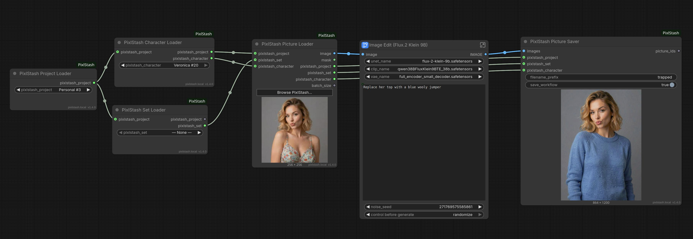](examples/PixlStash-SearchImageEdit.json)

**Outpaint.** Extend a vault image beyond its frame.

[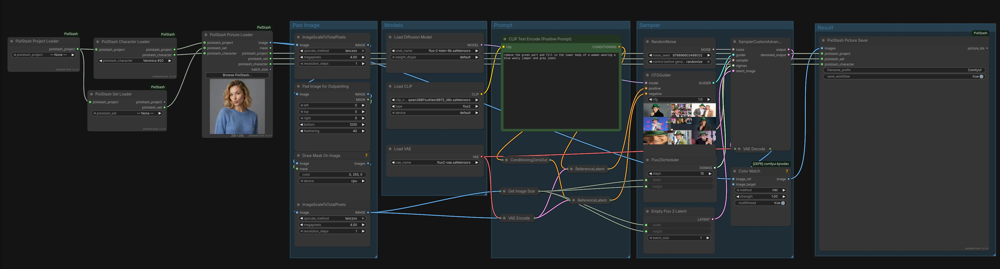](examples/PixlStash-Outpaint.json)

**Face Likeness Gate.** Keep only the frames matching a character.

[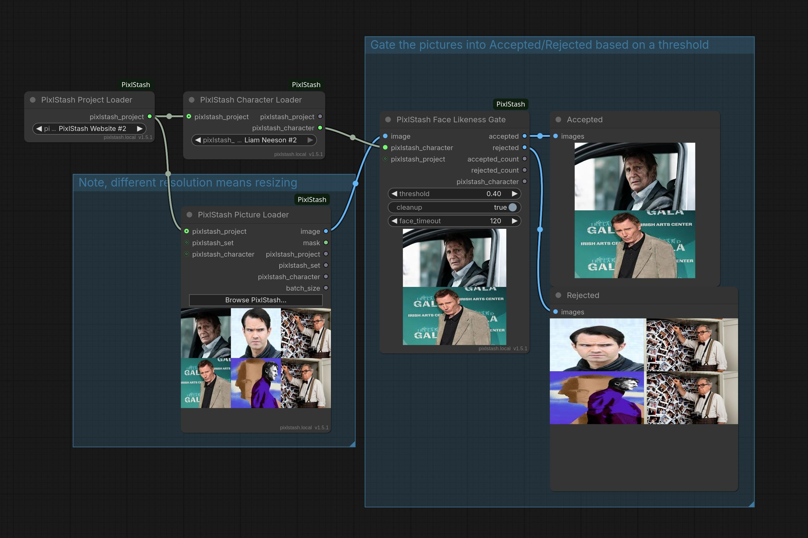](examples/PixlStash-FaceLikenessGate.json)

Or end to end: generate with a character LoRA, gate, upscale the matches, save
both streams to separate sets.

[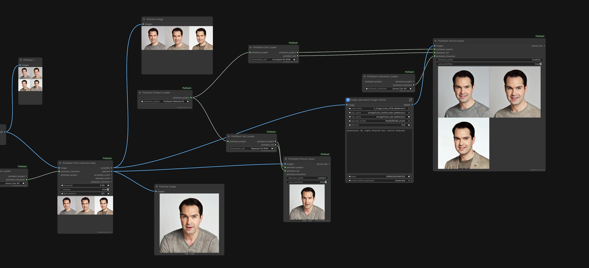](examples/PixlStash-FaceLikenessGate-Upscale.json)

The same pipeline with every model off the shelf:

[](examples/PixlStash-FaceLikenessGateUpscaleModels.json)

**Picture Likeness Gate.** Keep only the frames matching a reference set:
[bare](examples/PixlStash-PictureLikenessGate.json), or with upscale and save:

[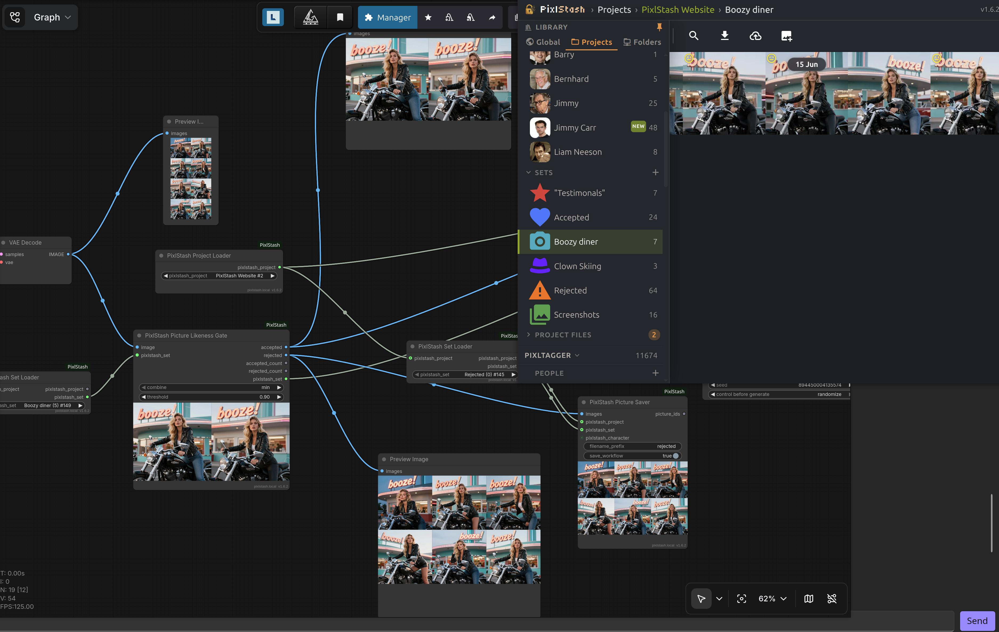](examples/PixlStash-PictureLikenessGateUpscale.json)

**Upscale.** Upscale a vault image and save it back with metadata intact.

[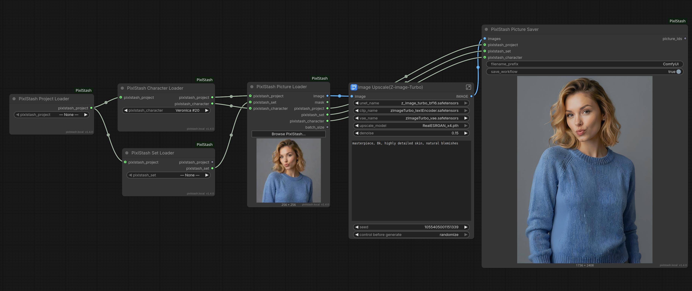](examples/PixlStash-Upscale.json)

**Generate from the model shelf.** Checkpoint, VAE and text encoder all picked
from a Browse grid, render saved straight into a project.

[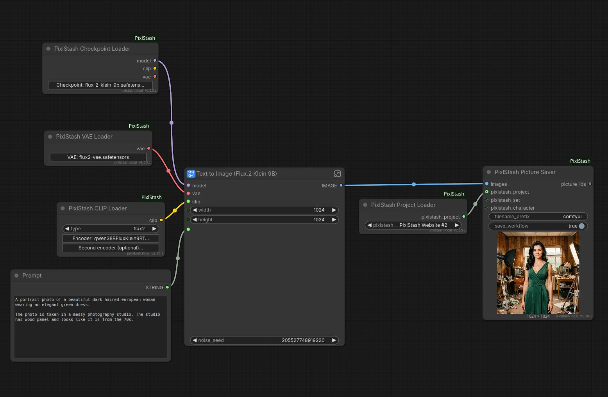](examples/PixlStash-Flux2-Models.json)

Some of these use subgraphs, so they need a recent ComfyUI. Bare diffusion
models like Flux.2 Klein 9B and Z-Image Turbo are filed as checkpoints, so only
the Checkpoint Loader's `model` output is wired and `clip` and `vae` come from
their own loaders.

## Installation

Search for **ComfyUI-PixlStash** in the ComfyUI Manager and click Install.

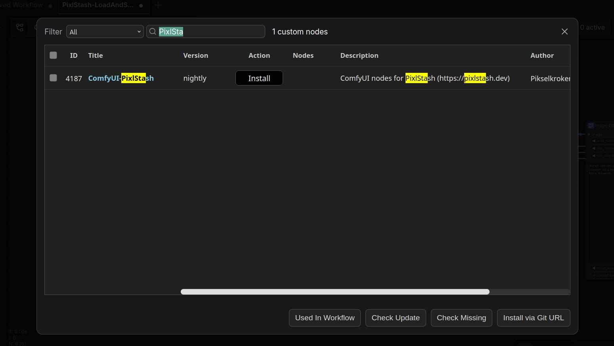

Or manually:

```bash
cd custom_nodes
git clone https://github.com/Pikselkroken/ComfyUI-PixlStash.git
```

Loading `.gguf` models needs the `gguf` Python package, which is not installed
with this pack. Run `pip install -U "gguf>=0.13.0"` in ComfyUI's environment if
you use GGUF models; the loader says so if it is missing or too old. A few GGUF text encoders (a Wan
UMT5, Gemma 3) also need `sentencepiece` and `protobuf` to rebuild their
tokenizer, and the error names them too.

Restart ComfyUI, then set your URL and API token under **Settings > PixlStash**.

## Configuration

| Setting | Description |
|---|---|
| URL | Base URL of your PixlStash instance |
| API Token | Token with the required read or write scope |
| Verify SSL | Whether to validate the server certificate |

> **Multi-user is not supported.** ComfyUI doesn't tell a node which user
> submitted the running prompt, so the nodes refuse to run rather than risk
> using someone else's token. Run one single-user ComfyUI per PixlStash user.

## Development

```bash
python -m unittest discover -s tests   # stdlib unittest, no ComfyUI needed
ruff check . && ruff format .
```

The tests stub ComfyUI's runtime modules, so only `requests` needs installing
(`pip install -r requirements.txt`). They cover the security-sensitive paths:
the multi-user guard, the proxy SSRF and auth checks, the token check and
filename containment on the two served endpoints, loader id extraction, and
path containment and digest verification in the savers and loaders.

Pull requests are reviewed by an AI reviewer (`.github/workflows/ai-review.yml`)
when the maintainer opens or pushes to one, or comments `/review`, `/improve`
or `/ask ...` on it. The rules it checks are in `.github/review-context.md`.

## License

MIT. See [LICENSE](LICENSE).

**No ComfyUI source is copied into this repository.** ComfyUI is GPL-3.0 and
this package is MIT, so everything here is written against ComfyUI's public
APIs: `comfy.utils` / `comfy.sd` for the model loaders, `folder_paths`,
`server.PromptServer` for the `/pixlstash/*` proxy, and `app.registerExtension`
plus LiteGraph for the frontend. The loaders mirror the *shape* of the built-ins
(inputs, outputs, widget names) so they drop into existing graphs, but none of
their code is reproduced here.

Runtime dependencies come from PyPI:
[requests](https://pypi.org/project/requests/) (Apache-2.0),
[Pillow](https://pypi.org/project/Pillow/) (MIT-CMU), and optionally
[gguf](https://pypi.org/project/gguf/) (MIT) for GGUF models. ComfyUI supplies
`torch` and `numpy`.

**Third-party code:** `vendor/comfyui_gguf/` is
[ComfyUI-GGUF](https://github.com/city96/ComfyUI-GGUF) by city96, Apache-2.0,
unmodified. See [vendor/comfyui_gguf/LICENSE](vendor/comfyui_gguf/LICENSE).
